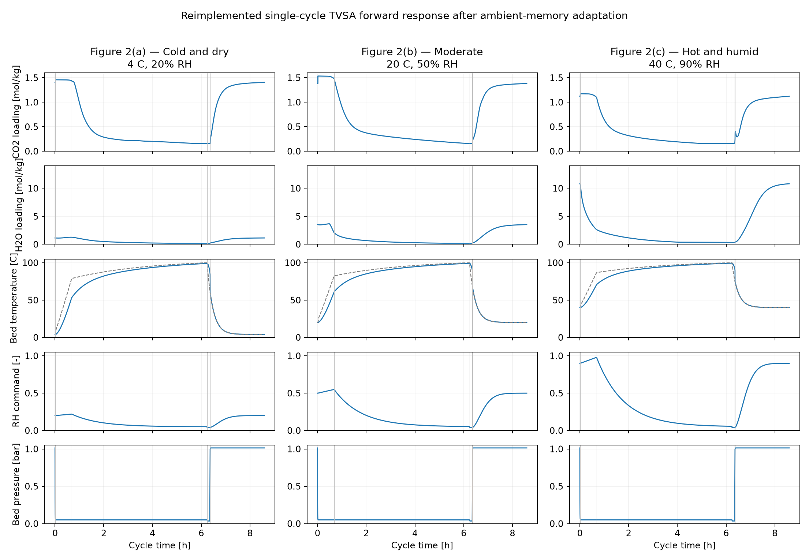

# Direct air capture: thermal modelling and cycle optimisation

A Python model of a temperature-vacuum swing adsorption (TVSA) process for capturing CO2 from air. The project examines how regeneration temperature, desorption time and ambient conditions affect capture productivity and heater energy consumption.

The work has two parts: a Python reproduction of a published MATLAB model, followed by a thermal extension with equipment limits and constrained optimisation. The baseline provides a numerical reference; the extension explores operating trade-offs.

## Engineering work

- Reproduced the six-stage adsorption cycle and compared the Python baseline with independent MATLAB exports.
- Replaced the prescribed temperature response with a lumped bed energy balance, including CO2/water sorption heat and gas-flow sensible heat.
- Added capacity-limited heating and cooling with on/off hysteresis control.
- Carried the bed state between cycles and evaluated fifth-cycle performance.
- Used SciPy COBYLA to minimise heater specific energy consumption (SEC), subject to at least 90% of baseline CO2 productivity.
- Investigated ambient conditions, operating conditions and time-step sensitivity.

## Reported result

The recorded optimisation study found a candidate near **95 C regeneration temperature and 23,077 s desorption time**, compared with a 100 C / 20,000 s baseline. Reported heater SEC fell from **1.995 to 1.949 kWh thermal/kg CO2**, a **2.31% reduction**, while productivity fell from **6.354 to 5.718 kg CO2/h**, close to the imposed minimum.

These are previously recorded simulation results, not a guarantee for every parameter revision or solver version. The optimisation uses a 1 s time step; the general evaluator defaults to 5 s. Re-run the study before using the figures as current results. See [results and interpretation](project_result.md).

## Run the project

Use Python 3.10 or later. From this folder in PowerShell:

```powershell
python -m venv .venv
.\.venv\Scripts\python.exe -m pip install -r requirements.txt
.\.venv\Scripts\python.exe run_cyclic_thermal.py
```

On macOS/Linux, use `.venv/bin/python` in place of `.\.venv\Scripts\python.exe`.

| Command (after the Python executable) | Purpose |
| --- | --- |
| `run_cyclic_thermal.py` | Run five cycles and print capture, productivity and thermal duties |
| `run_thermal.py` | Inspect one cycle and plot adsorption heat flows |
| `equipment_sizing.py` | Estimate sensible-only heating/cooling duties and conductances |
| `run_scipy.py` | Run the five-start constrained optimisation at a 1 s time step |
| `ambient_sensitivity.py` | Compare a 3 x 3 ambient grid; save CSV and display heatmaps |
| `operating_sensitivity.py` | Compare operating points near the candidate optimum |
| `check_timestep.py` | Compare baseline/candidate performance at 5 s and 1 s |
| `run_baseline.py` | Regenerate the three MATLAB-reference cases, CSVs and comparison figure |
| `validate_matlab_parity.py` | Compare regenerated baseline outputs with MATLAB exports |
| `-m pytest -q` | Run the regression and thermal model checks |

Optimisation and sensitivity sweeps run many five-cycle simulations and can take considerably longer than a single demonstration. Plotting scripts open Matplotlib windows.

For a direct calculation:

```python
from optimisation import evaluate

metrics = evaluate(T_regenC=100.0, t_des_s=20000.0, dt_s=5.0)
print(f"Productivity: {metrics['productivity']:.3f} kg CO2/h")
print(f"Heater SEC: {metrics['SEC']:.3f} kWh thermal/kg CO2")
```

## How the model works

Each cycle runs through vacuum, heating, desorption, cooling, pressurisation and adsorption. Pressure and humidity follow prescribed stage profiles. CO2 and water equilibria determine target loadings, and linear driving force kinetics describe the approach to equilibrium. Gas inventory and flow balances update the CO2 mole fraction.

The six states are fast/slow CO2 loading, free/bound water loading, gas CO2 mole fraction and bed temperature. Loadings are in mol/kg sorbent and temperature is in K internally.

The two simulators share the reference adsorption and gas-balance equations:

| File | Responsibility |
| --- | --- |
| `parameters.py` | Operating conditions, geometry, sorbent properties and equipment settings |
| `cycle_driver.py` | Stage schedule and prescribed pressure, humidity and temperature commands |
| `isotherms.py`, `kinetics.py` | Equilibrium relations and adsorption/desorption rates |
| `gas_balance.py` | Gas inventory, partial pressures, flow closure and CO2 fraction |
| `simulator.py` | MATLAB baseline with a prescribed first-order temperature lag |
| `simulator_thermal.py` | Thermal extension with an explicit bed energy balance |
| `thermal.py` | Heat capacity, sorption heat, heat transfer and equipment controllers |
| `energy.py` | Reference baseline energy accounting |
| `optimisation.py` | Fifth-cycle thermal performance evaluator used by the studies |

In the thermal extension, bed heat storage equals heater input plus sorption and inlet-gas heat, minus cooler duty and heat loss. Current assumptions include zero hardware heat capacity and zero ambient heat-loss conductance in `thermal.py`. Equipment settings are in `parameters.py`.

## Baseline example



The reference run shows sorbent loadings, bed temperature, humidity and pressure through each stage. This figure uses the prescribed-temperature baseline.

## Validation and limits

The prescribed-temperature baseline agrees with the MATLAB exports for three ambient cases: 4 C / 20% RH, 20 C / 50% RH and 40 C / 90% RH. The recorded comparison covers 17 columns at 6,185 time points per case, with a maximum absolute difference of 4.95e-10 (pressure in Pa).

That agreement applies to the baseline Figure 2 configuration. It does not validate the thermal extension against MATLAB or experiments. The baseline uses the source preconditioning/adaptation protocol; the thermal evaluator instead runs five consecutive cycles. Five cycles are a fixed evaluation procedure, not a checked periodic steady-state condition.

Heater SEC excludes fan and vacuum electricity and cooling utility energy. It cannot be compared directly with the baseline's electricity metric. The optimisation is a local, multi-start search under simplified thermal assumptions. Further details are in [validation status](documentation/VALIDATION_STATUS.md).

## Data and source material

- `validation_reference/`: MATLAB CSV exports used for regression tests; retain these in GitHub.
- `outputs/figures/`: example baseline comparison figure.
- `outputs/data/summary_metrics.csv`: compact baseline results. Large regenerated time-series CSVs are ignored by Git.
- Root sensitivity CSVs: recorded study outputs; rerunning a sweep overwrites the corresponding file.

## Development checks

```powershell
.\.venv\Scripts\python.exe -m pip install -r requirements-dev.txt
.\.venv\Scripts\python.exe -m ruff check .
.\.venv\Scripts\python.exe -m black --check .
.\.venv\Scripts\python.exe -m pytest -q
```


## Attribution

The reference adsorption framework, parameters and Figure 2 protocol come from:

An, K., Wald, D., Chen, K. & King, R. (2026). *Cycle-resolved dynamic modeling of atmospheric CO2 separation systems under time-varying ambient and electricity conditions*. Frontiers in Environmental Engineering 5:1881554. https://doi.org/10.3389/fenve.2026.1881554
