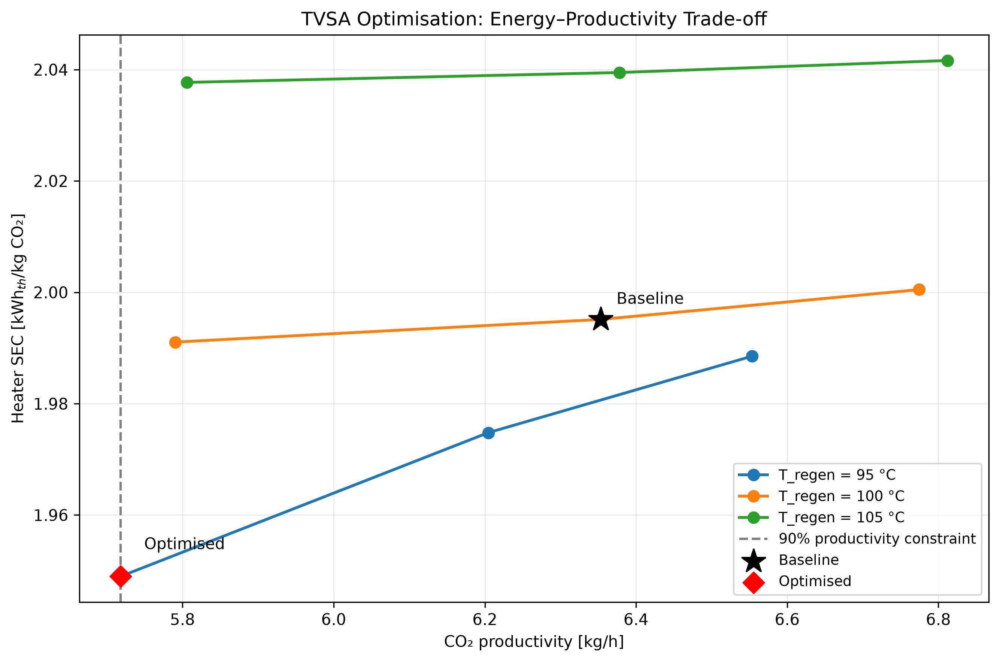
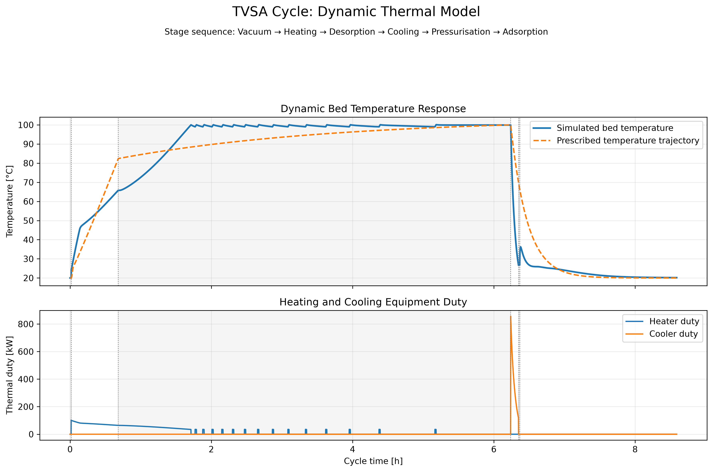
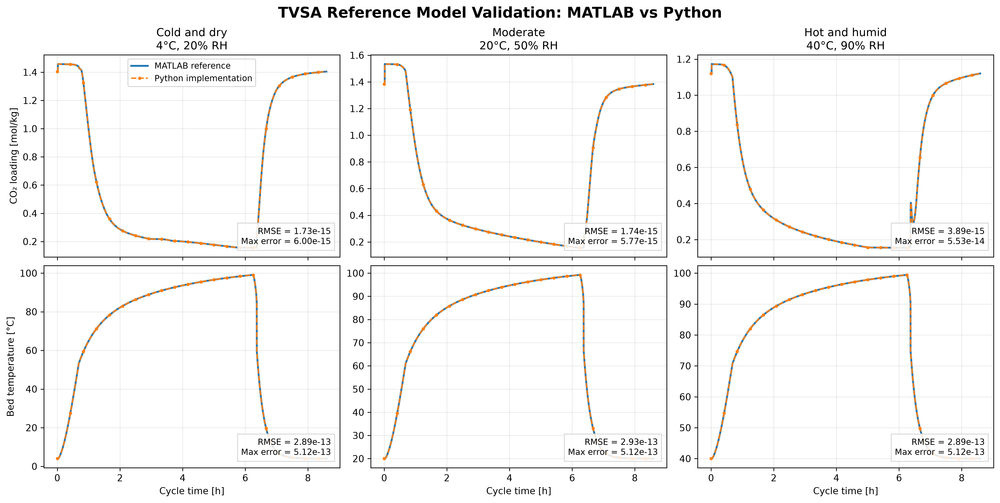

# Direct Air Capture | Reduced-Order TVSA Modelling and Thermal Optimisation

A Python modelling project investigating the performance of a temperature-vacuum swing adsorption (TVSA) process for direct air capture (DAC). The work combines a reproduction of a published reduced-order adsorption model with a dynamic thermal extension, operating-condition sensitivity studies, and constrained process optimisation.

**Key result:** At a 1-second simulation timestep, the selected operating point reduced **simulated heater-specific energy consumption (SEC) by 2.31%**, from **1.9951 to 1.9490 kWh_th/kg CO₂**, while maintaining approximately 90% of baseline CO₂ productivity. This is a model-based heater-energy result—not a measured reduction in total plant energy use.

## Engineering contributions

- **Reference-model reproduction:** Implemented the published six-stage reduced-order TVSA framework in Python and compared its outputs with stored MATLAB reference data.
- **Dynamic thermal extension:** Replaced the prescribed bed-temperature response with a lumped energy balance incorporating CO₂/H₂O sorption heat, gas-flow sensible heat, and capacity-limited heating/cooling with hysteresis control.
- **Process analysis and optimisation:** Evaluated repeated-cycle performance, performed operating and ambient sensitivity studies, and used SciPy COBYLA to investigate regeneration-temperature and desorption-time trade-offs under a minimum-productivity constraint.

## Key results

The optimisation was carried out at **20°C ambient temperature and 50% relative humidity**, using a 1-second timestep and the fifth of five simulated thermal cycles for performance evaluation.

| Metric | Baseline | Selected operating point |
|---|---:|---:|
| Regeneration temperature | 100°C | 95°C |
| Desorption duration | 20,000 s | 23,076.65 s |
| Heater SEC | 1.9951 kWh_th/kg CO₂ | 1.9490 kWh_th/kg CO₂ |
| CO₂ productivity | 6.3535 kg/h | 5.7183 kg/h |

The selected point satisfies the **90% baseline-productivity threshold at the reported precision**, but the margin is very small. It achieves lower heater SEC at the cost of approximately 10% lower CO₂ productivity. The search identifies a **local candidate**, not a proven global optimum.

### Energy–productivity trade-off



Nine simulated combinations of regeneration temperature and desorption duration illustrate the energy–productivity trade-off. Connecting the sampled points does **not** establish a Pareto frontier.

### Dynamic thermal response



The simulated bed temperature deviates from the prescribed temperature trajectory as heat storage, sorption heat and finite equipment duties are introduced. Heating and cooling transients are **model predictions**, not experimentally validated equipment duties.

### MATLAB–Python reference-model comparison



The prescribed-temperature Python baseline was compared with stored MATLAB reference outputs under three ambient conditions: **4°C/20% RH**, **20°C/50% RH**, and **40°C/90% RH**. The plotted CO₂-loading RMSEs were approximately **1.73–3.89 × 10⁻¹⁵ mol/kg**, and the bed-temperature RMSEs approximately **2.89–2.93 × 10⁻¹³ °C**. These results demonstrate numerical agreement with the reference datasets; they do **not** validate the separately developed thermal extension or establish experimental accuracy.

Additional figures: [baseline cycle profiles](outputs/figures/figure2_python_reimplementation.png), [adsorption heat-balance transient](outputs/figures/adsorption_thermal_balance.png), [operating and ambient sensitivities](outputs/figures/tvsa_sensitivity_analysis.png), and [baseline versus selected-point SEC](outputs/figures/optimisation_comparison.png).

For additional numerical interpretation, see [Results and Interpretation](project_result.md).

## Modelling methodology

### Reduced-order TVSA cycle

The reference framework represents six stages:

**Vacuum → Heating → Desorption → Cooling → Pressurisation → Adsorption**

It includes CO₂/H₂O adsorption equilibria, linear-driving-force kinetics, gas inventory/flow balances, and prescribed stage operating profiles. The six model states comprise fast/slow CO₂ loading, free/bound H₂O loading, gas-phase CO₂ mole fraction, and bed temperature. The reference baseline uses a prescribed temperature response; its model structure and parameters are attributed to the publication below.

### Dynamic bed energy balance

The thermal extension evaluates bed temperature using a lumped energy balance:

$$
C_{\mathrm{eff}}\frac{dT_{\mathrm{bed}}}{dt}
=\dot Q_{\mathrm{heater}}+\dot Q_{\mathrm{sorption}}
+\dot Q_{\mathrm{gas}}-\dot Q_{\mathrm{cooler}}-\dot Q_{\mathrm{loss}}.
$$

Here, $C_{\mathrm{eff}}$ is effective bed heat capacity (J/K), and each $\dot Q$ term is a heat-transfer rate (W), positive in the directions indicated by the equation. Sorption heat is calculated from the CO₂ and H₂O loading rates:

$$
\dot Q_{\mathrm{sorption}}=m_s\left(
\Delta H_{\mathrm{CO_2}}\frac{dq_{\mathrm{CO_2}}}{dt}
+\Delta H_{\mathrm{H_2O}}\frac{dq_{\mathrm{H_2O}}}{dt}
\right).
$$

The model includes conductance- and duty-limited heating/cooling with on/off hysteresis control. Temperature is updated using explicit timesteps. The current implementation sets hardware heat capacity and ambient heat-loss conductance to zero.

### Performance metrics and optimisation

Five consecutive thermal cycles are simulated, passing the final state into the next cycle. Performance is assessed on the fifth cycle; **periodic cyclic steady state has not been demonstrated**.

$$
P_{\mathrm{CO_2}}=\frac{m_{\mathrm{CO_2,captured}}}{t_{\mathrm{cycle}}},
\qquad
SEC_{\mathrm{heater}}=\frac{E_{\mathrm{heater}}}{m_{\mathrm{CO_2,captured}}}.
$$

COBYLA searches over **80–120°C** regeneration temperature and **14,000–26,000 s** desorption duration, using five starting points, subject to:

$$
P_{\mathrm{CO_2}}\geq0.90P_{\mathrm{baseline}}.
$$

This objective includes **heater thermal energy only**; vacuum/fan electricity and cooling utility energy are not included.

### Main code modules

| File | Purpose |
|---|---|
| `parameters.py`, `cycle_driver.py` | Process parameters and six-stage operating schedule |
| `isotherms.py`, `kinetics.py`, `gas_balance.py` | Adsorption, kinetics and gas inventory calculations |
| `simulator.py` | Python reproduction of the prescribed-temperature reference model |
| `simulator_thermal.py`, `thermal.py` | Dynamic thermal model, heat balance and equipment control |
| `optimisation.py` | Repeated-cycle performance evaluator |
| `run_scipy.py` | Multi-start constrained optimisation |

## Validation scope and limitations

- **Reference-model comparison:** Numerical agreement is with the stored MATLAB reference CSVs. The provenance and redistribution permissions of reference materials should be confirmed independently. This is not experimental validation.
- **Thermal assumptions:** One lumped bed temperature; no resolved spatial gradients, equipment thermal inertia or ambient heat losses. Predicted initial adsorption heat and peak cooling duties have not been independently validated.
- **Numerical sensitivity:** The reported 2.31% improvement is at a 1-second timestep. The same candidate yields approximately **2.05%** at 5 seconds; a full timestep-convergence study has not been completed.
- **Cycle and optimiser limitations:** Fifth-cycle performance does not establish cyclic steady state. COBYLA searches locally; the optimum lies very close to the productivity constraint, with a small solver feasibility tolerance.
- **System boundaries:** Heater SEC excludes vacuum/fan electricity and cooling energy and should not be presented as a whole-plant energy reduction.

Potential next steps include numerical/cyclic convergence studies, equipment heat-capacity and heat-loss modelling, more complete utility accounting, and independent thermal-model validation.

## Installation and reproducibility

**Requirements:** Python 3.10 or later; packages are listed in [`requirements.txt`](requirements.txt). Dependency lower bounds are specified, but the exact environment has not been locked.

Clone the repository:

```bash
git clone https://github.com/uhrenhwan/direct-air-capture-modelling.git
cd direct-air-capture-modelling
```

Create a virtual environment and install the dependencies on **Windows PowerShell**:

```powershell
py -3 -m venv .venv
.\.venv\Scripts\python.exe -m pip install -r requirements.txt
```

On macOS/Linux, use `python3 -m venv .venv` and `.venv/bin/python -m pip install -r requirements.txt` instead.

Run the main simulations and checks (Windows commands shown):

```powershell
.\.venv\Scripts\python.exe run_baseline.py
.\.venv\Scripts\python.exe run_cyclic_thermal.py
.\.venv\Scripts\python.exe run_scipy.py
.\.venv\Scripts\python.exe check_timestep.py
.\.venv\Scripts\python.exe validate_matlab_parity.py
```

To regenerate the figures, run the relevant scripts after installation:

| Script | Output |
|---|---|
| `plot_optimisation.py` | Baseline versus selected-point heater SEC |
| `run_baseline.py` | Reference-model cycle profiles and CSVs |
| `run_thermal.py` | Adsorption heat-balance transient |
| `plot_cycle_temperature.py` | Dynamic bed temperature and equipment duty |
| `plot_tradeoff.py` | Heater SEC versus productivity |
| `plot_sensitivities.py` | Operating and ambient sensitivity panels |
| `plot_model_validation.py` | MATLAB–Python overlays and error metrics (run `run_baseline.py` first) |

Figures are written to `outputs/figures/`; numerical outputs are written to `outputs/data/`. Some scripts perform many five-cycle simulations and may take substantially longer than a single model run.

## Attribution and reference data

The reference adsorption framework, parameters and baseline protocol are attributed to:

An, K., Wald, D., Chen, K. & King, R. (2026). *Cycle-resolved dynamic modeling of atmospheric CO2 separation systems under time-varying ambient and electricity conditions*. **Frontiers in Environmental Engineering**, 5, 1881554. https://doi.org/10.3389/fenve.2026.1881554

